# Roadmap — ASTRANUSA

Roadmap ini mendefinisikan tahapan implementasi bertahap. Setiap tahap memiliki tujuan, hasil kerja utama, ketergantungan, dan kriteria keluar. Setiap tahap wajib melewati proses SDD: Requirement Analysis, Technical Design, Specification, Implementation, Verification, Code Audit, dan Acceptance.

## Aturan Umum Tahapan

1. Sebuah tahap tidak boleh dimulai sebelum tahap sebelumnya mencapai status Accepted.
2. Sebuah fitur tidak boleh diimplementasikan sebelum spesifikasinya disetujui.
3. Setiap tahap menghasilkan satu laporan tahap pada `docs/sdd/reports/`.
4. Estimasi durasi tidak dinyatakan dalam satuan waktu karena pengembangan dilakukan bertahap dengan bantuan AI; kemajuan diukur berdasarkan kriteria keluar.

## Daftar Tahapan

| Tahap | Nama | Tujuan Utama | Kriteria Keluar Utama |
| --- | --- | --- | --- |
| SDD-00 | Project Foundation | Fondasi dokumentasi: overview, arsitektur, decision log, roadmap, struktur SDD. | Dokumen fondasi disetujui; repository terinisialisasi dengan struktur dasar. |
| SDD-01 | Repository & CI Foundation | Inisialisasi proyek Godot 4 pada `game/`, workflow validasi dan pengujian dasar, penguncian versi. | CI berjalan hijau pada proyek kosong; versi Godot dan dependensi terkunci; keputusan O-001 hingga O-004, O-008, O-016 diselesaikan. |
| SDD-02 | Core Framework | Layanan inti: event bus, scene router, config service, save service, state machine, object pool. | Layanan inti berfungsi dan memiliki unit test yang berjalan di CI. |
| SDD-03 | Data Layer | Skema dan validator data konfigurasi (hero, item, emblem, battle spell, rank, nickname); data sampel satu hero. | Validasi konfigurasi berjalan di CI; keputusan O-005 dan O-006 diselesaikan. |
| SDD-04 | Lobby Shell | Struktur lobby: bottom navigation lima tab, header profil, placeholder 3D showcase, penyimpanan profil lokal. | Lobby dapat dinavigasi; profil tersimpan antar sesi; keputusan O-010 dan O-013 diselesaikan. |
| SDD-05 | Match Skeleton | Blockout peta tiga lane dan jungle, kamera, input sentuh, gerakan unit, spawn minion. | Peta dapat dilalui; simulasi gerak berjalan headless; keputusan O-012 diselesaikan. |
| SDD-06 | Combat Core | Statistik unit, damage pipeline, status effect, framework ability (passive, Skill 1, Skill 2, Ultimate); satu hero uji dapat dimainkan. | Pertarungan dasar berfungsi dan teruji headless. |
| SDD-07 | Map Systems | Turret, Base Core, jungle monster, respawn, ekonomi gold dan XP, concealment rumput. | Satu siklus pertandingan penuh berakhir dengan hancurnya Base Core secara headless; keputusan O-011 diselesaikan. |
| SDD-08 | AI Bots | AI berlapis (strategic, tactical, operational), pembagian role dan fungsi jungler, profile kesulitan per tier rank. | Bot menyelesaikan objektif; tier kesulitan lebih tinggi terbukti lebih baik melalui simulasi antar bot; keputusan O-007 diselesaikan. |
| SDD-09 | Match Flow & Modes | Alur draft dan pertandingan, empat mode (Classic, Ranked, Practice, Custom), layar hasil, integrasi announcer. | Empat mode dapat dimainkan offline; keputusan O-015 diselesaikan. |
| SDD-10 | Progression & Rank | Progresi rank dan divisi, penyimpanan integritas lokal, nickname bot. | Progresi rank bertahan antar pertandingan; keputusan O-009 diselesaikan. |
| SDD-11 | Content Production | 15 hero lengkap beserta data item, emblem, dan battle spell. | Seluruh konten lolos validasi CI; keputusan O-014 diselesaikan. |
| SDD-12 | Polish & Performance | HUD final, settings, audio, announcer lengkap, optimasi kinerja dan memori. | Anggaran kinerja dan memori terpenuhi pada perangkat target; keputusan O-017 diselesaikan. |
| SDD-13 | Release Candidate | Workflow export APK final, artifact, verifikasi manual, versioning. | APK dapat dibangun secara konsisten oleh CI dan lolos acceptance manual. |

## Diagram Ketergantungan Tahapan

```mermaid
graph LR
    S00[SDD-00 Foundation] --> S01[SDD-01 Repo & CI]
    S01 --> S02[SDD-02 Core Framework]
    S02 --> S03[SDD-03 Data Layer]
    S02 --> S04[SDD-04 Lobby Shell]
    S03 --> S05[SDD-05 Match Skeleton]
    S05 --> S06[SDD-06 Combat Core]
    S06 --> S07[SDD-07 Map Systems]
    S07 --> S08[SDD-08 AI Bots]
    S08 --> S09[SDD-09 Match Flow & Modes]
    S09 --> S10[SDD-10 Progression & Rank]
    S10 --> S11[SDD-11 Content Production]
    S11 --> S12[SDD-12 Polish & Performance]
    S12 --> S13[SDD-13 Release Candidate]
```

Catatan ketergantungan:

1. SDD-04 (Lobby Shell) hanya bergantung pada SDD-02; namun penyelesaian aset 3D showcase bergantung pada keputusan O-010 yang juga memengaruhi SDD-11.
2. SDD-08 membutuhkan SDD-07 karena perilaku AI membutuhkan seluruh sistem peta yang berfungsi.
3. SDD-11 dan SDD-12 dapat berjalan sebagian bersamaan setelah SDD-10, dengan koordinasi melalui spesifikasi masing-masing.

## Cara Membaca Roadmap Ini

1. Setiap tahap dimulai dengan dokumen requirement yang menggunakan [TEMPLATE-REQ](templates/TEMPLATE-REQ.md).
2. Desain teknis menggunakan [TEMPLATE-DESIGN](templates/TEMPLATE-DESIGN.md), dan spesifikasi implementasi menggunakan [TEMPLATE-SPEC](templates/TEMPLATE-SPEC.md).
3. Status setiap tahap dilaporkan menggunakan [TEMPLATE-REPORT](templates/TEMPLATE-REPORT.md) dan disimpan pada `docs/sdd/reports/`.
