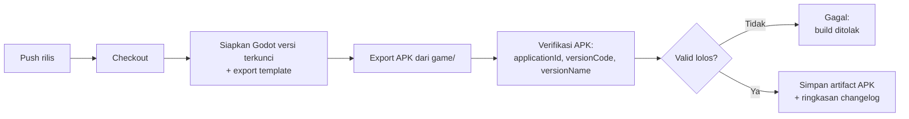

# APK-COMPATIBILITY-SPEC: Spesifikasi Kompatibilitas APK dan Workflow Build

- Status: Approved (disetujui pemilik proyek pada 2026-10-30)
- Sistem: Android Packaging & CI Release
- Tahap roadmap terikat: SDD-01 (fondasi CI), SDD-13 (release candidate)
- Terakhir diperbarui: 2026-10-30

## 1. Tujuan

Memastikan setiap APK rilis ASTRANUSA dapat dipasang sebagai pembaruan langsung atas versi sebelumnya, dengan identitas paket konsisten, penomoran versi meningkat, dan signing key yang tidak berubah.

## 2. Ruang Lingkup

Dalam lingkup: identitas paket Android, kebijakan versionCode dan versionName, signing key, konfigurasi export Godot, dan rancangan workflow GitHub Actions untuk build APK rilis.

Di luar lingkup: alur pembaruan dari sisi pemain (lihat [UPDATE-SYSTEM-SPEC](UPDATE-SYSTEM-SPEC.md)) dan struktur data pemain (lihat [DATA-PERSISTENCE-SPEC](DATA-PERSISTENCE-SPEC.md)).

## 3. Identitas Paket (applicationId)

1. `applicationId` dikunci pada nilai: `com.ndolzz.astranusa` (P-003, disetujui 2026-10-30).
2. Mengubah `applicationId` mengakibatkan Android memperlakukan APK sebagai aplikasi baru: data pemain pada instalasi lama tidak dapat diakses aplikasi baru.
3. Karena itu perubahan `applicationId` dilarang tanpa rencana migrasi khusus yang disetujui pemilik proyek dan didokumentasikan pada Decision Log.
4. Workflow CI memvalidasi `applicationId` hasil build sama dengan nilai yang dikunci; ketidaksesuaian menggagalkan build.

## 4. versionCode

1. `versionCode` adalah bilangan bulat yang harus meningkat pada setiap rilis.
2. Sumber kebenaran versi adalah berkas `game/version.json` pada repository (P-004, disetujui 2026-10-30):

```json
{
  "versionCode": 3,
  "versionName": "0.1.2"
}
```

3. Pada saat export, nilai tersebut disuntik ke konfigurasi export sehingga APK selalu konsisten dengan repository.
4. Workflow CI memastikan `versionCode` rilis baru lebih tinggi daripada `versionCode` rilis sebelumnya; jika tidak, build gagal sebelum APK didistribusikan.
5. Perubahan `versionCode` hanya dilakukan melalui commit yang terdokumentasi; tidak ada pembubuhan angka versi otomatis dari nomor eksekusi CI.

## 5. versionName

1. `versionName` mengikuti semantic versioning: `MAJOR.MINOR.PATCH` (P-005, disetujui 2026-10-30; menyelesaikan O-016).
2. Selama pengembangan pra-rilis digunakan segmen `0.x.y`: `0` menandakan belum rilis publik pertama.
3. `versionName` wajib konsisten antara `game/version.json`, catatan perubahan (changelog), dan penanda rilis pada repository.
4. Workflow CI memvalidasi format `versionName` sebelum build.

## 6. Signing Key

1. Seluruh build produksi ditandatangani dengan satu keystore produksi yang konsisten.
2. Keystore produksi disimpan sebagai GitHub Secrets (berkas keystore terenkode base64, kata sandi keystore, dan kata sandi key); tidak ada berkas keystore pada repository dan tidak ada nilai rahasia pada log build.
3. Build pengembangan (debug) menggunakan keystore debug bawaan dan tidak boleh didistribusikan sebagai pembaruan; pemasangan APK debug atas APK rilis akan ditolak Android karena tanda tangan berbeda.
4. Skema tanda tangan yang diaktifkan: v2 dan v3 (bawaan export Godot untuk rilis).
5. Rotasi signing key hanya boleh dilakukan dengan rencana rotasi yang didokumentasikan (memakai mekanisme key rotation Android) karena rotasi yang salah membuat pembaruan tertolak; provisioning keystore produksi dicatat pada O-018.

## 7. Konfigurasi Export Godot

1. Export preset rilis Android menggunakan: Mobile Renderer (D-003), arsitektur target ditetapkan pada desain SDD-01, versi Godot dan export template terkunci (O-001).
2. Nilai `applicationId`, `versionCode`, dan `versionName` pada preset export dibaca dari `game/version.json` melalui skrip export headless; tidak ada nilai versi yang ditulis manual pada preset.
3. `minSdk` mengikuti keputusan O-008 yang ditetapkan pada SDD-01.

## 8. Rancangan Workflow Build APK



Ketentuan workflow:

1. Pemicu: eksekusi manual dan penanda rilis; bukan setiap push agar artifact rilis hanya dihasilkan saat diminta.
2. Versi Godot, export template, dan komponen Android SDK yang dipakai dikunci pada workflow; perubahan versi melewati Decision Log.
3. Langkah verifikasi membandingkan APK baru dengan rilis sebelumnya: `applicationId` harus sama, `versionCode` harus lebih tinggi, `versionName` harus sesuai `game/version.json`.
4. Artifact APK disimpan sebagai workflow artifact dengan masa retensi terdefinisi dan dilampiri ringkasan catatan perubahan dari `CHANGELOG.md`.
5. Kredensial hanya diakses melalui konteks Secrets; tidak ada perintah yang mencetak nilainya.
6. Workflow tidak mengirim APK ke layanan eksternal apa pun.

## 9. Kredensial yang Dikelola

| Secret | Fungsi |
| --- | --- |
| `ANDROID_KEYSTORE_BASE64` | Berkas keystore produksi terenkode. |
| `ANDROID_KEYSTORE_PASSWORD` | Kata sandi keystore. |
| `ANDROID_KEY_PASSWORD` | Kata sandi key alias produksi. |

Pembuatan keystore produksi, penyimpanan cadangan aman, dan kepemilikannya ditetapkan pada O-018 sebelum rilis pertama yang ditandatangani produksi.

## 10. Acceptance Criteria

- [ ] Setiap APK rilis memiliki `applicationId` sama dengan nilai yang dikunci.
- [ ] `versionCode` rilis baru selalu lebih tinggi daripada rilis sebelumnya dan berasal dari `game/version.json`.
- [ ] `versionName` mengikuti semantic versioning dan konsisten dengan changelog.
- [ ] APK rilis ditandatangani dengan keystore produksi yang sama antar versi.
- [ ] APK rilis baru terpasang di atas versi lama tanpa uninstall.
- [ ] Workflow menghasilkan artifact APK dan ringkasan catatan perubahan.
- [ ] Tidak ada kredensial pada repository maupun log workflow.
- [ ] Build gagal ketika validasi identitas atau versi tidak lolos.

## 11. Referensi

- [UPDATE-SYSTEM-SPEC](UPDATE-SYSTEM-SPEC.md)
- [DATA-PERSISTENCE-SPEC](DATA-PERSISTENCE-SPEC.md)
- [UPDATE-TEST-PLAN](../verification/UPDATE-TEST-PLAN.md)
- [Decision Log](../../DECISION_LOG.md): P-003, P-004, P-005, O-001, O-008, O-016, O-018
