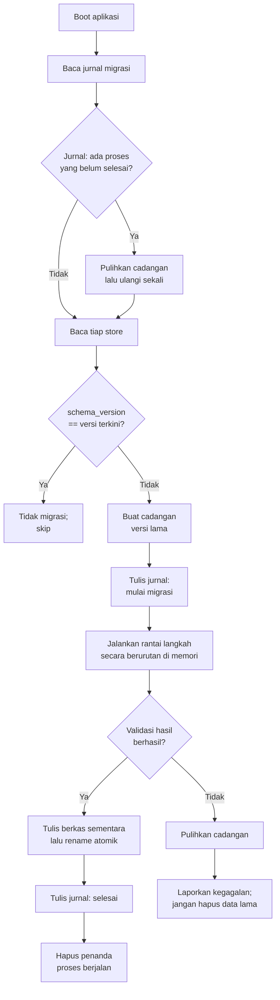

# DATA-MIGRATION-SPEC: Spesifikasi Migrasi Data

- Status: Approved (disetujui pemilik proyek pada 2026-10-30)
- Sistem: Save Migration
- Tahap roadmap terikat: SDD-02 (kerangka migrasi), SDD-03 (schema data), SDD-10 (schema rank), SDD-12 (verifikasi penuh)
- Terakhir diperbarui: 2026-10-30

## 1. Tujuan

Spesifikasi ini mendefinisikan mekanisme pembaruan struktur data pemain (schema) antar versi aplikasi dengan prioritas: data lama tidak hilang, migrasi otomatis, aman terhadap gangguan proses, dan tidak dijalankan berulang.

## 2. Ruang Lingkup

Dalam lingkup:

1. Identitas versi schema per store.
2. Registri dan rantai langkah migrasi.
3. Cadangan sebelum migrasi.
4. Jurnal migrasi dan ketahanan terhadap proses yang terhenti.
5. Penanganan kegagalan dan pemulihan.

Di luar lingkup: struktur isi tiap store per versi (didefinisikan pada spesifikasi sistem terkait).

## 3. Identitas Versi Schema

1. Setiap store memiliki `schema_version` sendiri pada amplop berkas (lihat [DATA-PERSISTENCE-SPEC](DATA-PERSISTENCE-SPEC.md) bagian 7).
2. Versi schema bersifat independen antar store: `player_profile` dapat berada pada versi 3 sementara `settings` masih versi 1.
3. Versi schema tidak sama dengan versi aplikasi; satu rilis aplikasi boleh tidak mengubah schema sama sekali.
4. Kenaikan versi schema hanya satu tingkat per langkah migrasi (1 → 2 → 3), terlepas dari berapa versi yang dilewati aplikasi.

## 4. Registri dan Rantai Migrasi

1. Seluruh langkah migrasi terdaftar pada registri dalam kode, terurut menaik: `migrate_1_to_2`, `migrate_2_to_3`, dan seterusnya, per store.
2. Setiap langkah migrasi adalah fungsi murni: menerima struktur data versi lama, mengembalikan struktur data versi baru, tanpa efek samping berkas.
3. Setiap langkah migrasi wajib memiliki unit test yang menggunakan fixture data versi lama.
4. Tidak ada langkah migrasi yang boleh dihapus setelah dirilis; koreksi dilakukan dengan menambah langkah baru.
5. Registri dapat dijalankan headless untuk pengujian CI: mode `--migrate-only` membaca store fixture, menjalankan rantai migrasi, dan melaporkan hasil tanpa membuka game penuh.

## 5. Alur Migrasi Otomatis

Migrasi dijalankan pada saat boot sebelum scene manapun membaca data pemain:

Ketentuan alur:

1. Data lama tidak dihapus pada tahap manapun; cadangan tetap berada pada `user://saves/backup/` sampai masa retensi habis.
2. Rantai migrasi dikerjakan sepenuhnya di memori sebelum penulisan; berkas store lama tetap utuh sampai rename atomik berhasil.
3. Setelah migrasi berhasil, `schema_version` store sama dengan versi terkini sehingga peluncuran berikutnya tidak menjalankan migrasi ulang.
4. Migrasi lintas banyak versi dilayani oleh rantai langkah: data versi 1 pada aplikasi versi terbaru menjalankan 1 → 2 → 3 secara berurutan.

## 6. Cadangan (Backup)

1. Sebelum migrasi, store versi lama disalin ke `user://saves/backup/<store_name>.v<schema_version_lama>.bak`.
2. Retensi: paling banyak dua cadangan terbaru per store; cadangan lebih lama dihapus dengan urutan terlama lebih dahulu.
3. Cadangan tidak pernah dihapus ketika migrasi gagal.
4. Penghapusan cadangan hanya boleh dilakukan oleh kebijakan retensi, bukan oleh proses lain.

## 7. Jurnal Migrasi dan Ketahanan Gangguan

1. Berkas jurnal: `user://saves/migration_journal.json` dengan status `idle`, `in_progress`, atau `completed` per store, beserta stempel waktu dan versi sumber.
2. Sebelum menjalankan langkah migrasi pertama, jurnal ditulis `in_progress`.
3. Jika aplikasi berhenti di tengah migrasi, jalan pengaman berikut berlaku:
   a. berkas store target masih versi lama atau berkas sementara yang terabaikan (keduanya tidak merusak data); rename atomik memastikan tidak ada kondisi setengah tertulis;
   b. pada boot berikutnya, jurnal `in_progress` memicu pemulihan cadangan, lalu percobaan migrasi diulang maksimal satu kali;
   c. berkas sementara yang terabaikan dibersihkan pada boot.
4. Seluruh langkah rantai idempoten terhadap input versi lama yang sama; menjalankan ulang memberikan hasil identik.

## 8. Kegagalan Migrasi dan Pemulihan

1. Kegagalan mencakup: checksum store lama tidak valid, langkah migrasi menghasilkan data yang tidak lolos validasi, pengecualian tak terduga, dan ruang penyimpanan habis.
2. Prosedur kegagalan: pulihkan cadangan ke berkas store, tandai store `schema_version` tetap versi lama, catat kegagalan pada log internal, dan tampilkan pesan kepada pemain.
3. Game tetap dapat dijalankan dengan data versi lama hanya jika kode versi terkini masih dapat membacanya; jika tidak, store terkait dinonaktifkan menjadi mode aman (misalnya statistik tampilan kosong) tanpa menghapus data, dan pemain diberi informasi.
4. Kegagalan satu store tidak menghentikan migrasi store lain.
5. Tidak ada jalur kode yang boleh menginisialisasi ulang atau menghapus store sebagai akibat kegagalan migrasi.

## 9. Ruang Penyimpanan

1. Sebelum migrasi, layanan memeriksa ruang bebas minimal dua kali ukuran store terbesar ditambah estimasi cadangan.
2. Jika tidak mencukupi, migrasi ditunda dengan pesan yang jelas; data tetap versi lama dan tidak terkorupsi.

## 10. Larangan Migrasi Berulang

1. Migrasi hanya berjalan ketika `schema_version` store lebih rendah dari versi terkini.
2. Setelah berhasil, jurnal `completed` dan `schema_version` baru mencegah eksekusi ulang.
3. Boot normal tanpa perubahan versi tidak boleh melakukan penulisan apa pun pada store.

## 11. Acceptance Criteria

- [ ] Migrasi berjalan otomatis pada boot pertama setelah pembaruan.
- [ ] Cadangan dibuat sebelum setiap migrasi dan bertahan sesuai kebijakan retensi.
- [ ] Proses yang terhenti di tengah migrasi menghasilkan pemulihan otomatis pada boot berikutnya tanpa kehilangan data.
- [ ] Migrasi gagal mengembalikan cadangan dan tidak pernah menghapus data lama.
- [ ] Migrasi yang sudah berhasil tidak dijalankan ulang pada boot berikutnya.
- [ ] Lompatan beberapa versi schema dijalankan melalui rantai langkah yang benar.
- [ ] Seluruh langkah migrasi memiliki unit test dengan fixture versi lama.
- [ ] Mode `--migrate-only` tersedia untuk CI headless.

## 12. Referensi

- [DATA-PERSISTENCE-SPEC](DATA-PERSISTENCE-SPEC.md)
- [UPDATE-SYSTEM-SPEC](UPDATE-SYSTEM-SPEC.md)
- [UPDATE-TEST-PLAN](../verification/UPDATE-TEST-PLAN.md)
- [Decision Log](../../DECISION_LOG.md): P-006
