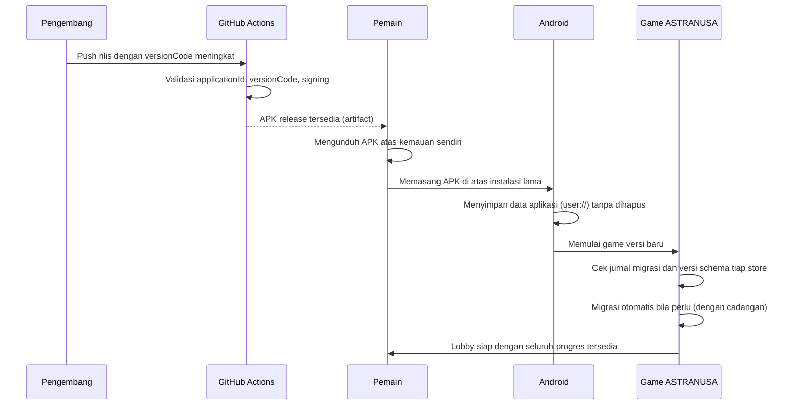

# UPDATE-SYSTEM-SPEC: Spesifikasi Sistem Pembaruan

- Status: Approved (disetujui pemilik proyek pada 2026-10-30)
- Sistem: Update System & Asset Management
- Tahap roadmap terikat: SDD-01 (versi dan CI), SDD-02 (SaveService), SDD-03 (data), SDD-11 hingga SDD-13 (aset dan rilis)
- Terakhir diperbarui: 2026-10-30

## 1. Tujuan dan Batasan

Sistem pembaruan memastikan pemain dapat memasang APK terbaru langsung di atas instalasi sebelumnya tanpa menghapus aplikasi, dan seluruh progres pemain tetap tersedia setelah pembaruan.

Batasan yang mengikat:

1. ASTRANUSA berjalan sepenuhnya offline; koneksi internet hanya dibutuhkan ketika pemain mengunduh berkas APK pembaruan atas kemauannya sendiri.
2. Game tidak boleh mengunduh atau memasang APK secara otomatis; setiap pembaruan memerlukan tindakan dan persetujuan pemain.
3. Progres pemain tidak boleh bergantung pada layanan cloud.
4. Pemain tidak boleh diminta menghapus aplikasi sebelum memasang versi baru.

## 2. Ruang Lingkup

Dalam lingkup: model distribusi pembaruan, alur pembaruan, pengelolaan aset, urutan boot setelah pembaruan, komunikasi versi kepada pemain, dan register risiko kehilangan data.

Di luar lingkup: implementasi workflow CI (dirinci pada [APK-COMPATIBILITY-SPEC](APK-COMPATIBILITY-SPEC.md)) dan struktur store data pemain (lihat [DATA-PERSISTENCE-SPEC](DATA-PERSISTENCE-SPEC.md)).

## 3. Model Distribusi

1. Distribusi menggunakan APK penuh: satu berkas APK berisi seluruh aplikasi dan aset bawaan versi terbaru.
2. Pemain memperoleh APK dari saluran yang dipilih pemilik proyek (misalnya GitHub Releases); game tidak memeriksa pembaruan secara aktif dan tidak menampilkan penawaran unduhan otomatis.
3. Setiap rilis menyertakan catatan versi (versionName) dan daftar perubahan; catatan ini juga dibundel ke dalam APK dan dapat dilihat dari menu Settings tanpa koneksi internet.

## 4. Alur Pembaruan End-to-End

Syarat agar pembaruan langsung berhasil (diperinci pada [APK-COMPATIBILITY-SPEC](APK-COMPATIBILITY-SPEC.md)):

1. `applicationId` sama dengan versi lama.
2. Signing key sama dengan versi terpasang.
3. `versionCode` lebih tinggi dari versi terpasang.

## 5. Pengelolaan Aset

### 5.1 Kategori Aset

| Kategori | Lokasi | Diperbarui Cara |
| --- | --- | --- |
| Aset bawaan | `res://assets/` di dalam APK | Selalu diganti bersama APK. |
| Aset tambahan yang dapat diperbarui | `user://assets_override/` | Melalui paket aset opsional, dikelola manifest. |
| Data pemain | `user://saves/` | Tidak pernah disentuh oleh proses aset. |

### 5.2 Ketentuan Aset Tambahan

1. Aset tambahan dikelola oleh manifest: `user://assets_override/manifest.json` mencantumkan identifikasi berkas, versi, dan checksum tiap aset.
2. Penerapan paket aset membandingkan manifest lama dan baru, lalu hanya menyalin berkas yang berubah; berkas yang tidak berubah tidak disalin ulang.
3. Pembersihan aset usang (ada di manifest lama, tidak ada di manifest baru) hanya menyentuh `user://assets_override/`, tidak pernah `user://saves/`.
4. Jika rilis awal tidak memuat aset tambahan sama sekali, mekanisme manifest tetap disiapkan tanpa dipakai; keputusan cakupan dicatat pada O-020.
5. Pemuatan aset memeriksa `res://` sebagai sumber dasar dan `user://assets_override/` sebagai penimpa (override); berkas override rusak diabaikan dengan peringatan dan sumber dasar dipakai.

## 6. Urutan Boot Setelah Pembaruan

1. Baca versi aplikasi terkini.
2. Inisialisasi layanan inti minimal.
3. Bersihkan berkas sementara `user://tmp/`.
4. Periksa jurnal migrasi; pulihkan cadangan bila ada proses yang belum selesai (lihat [DATA-MIGRATION-SPEC](DATA-MIGRATION-SPEC.md)).
5. Periksa versi schema tiap store; jalankan migrasi otomatis bila perlu.
6. Periksa manifest aset; sesuaikan override bila ada paket baru yang diterapkan.
7. Muat profil dan masuk ke lobby.

## 7. Komunikasi kepada Pemain

1. Versi aplikasi ditampilkan pada menu Settings dan layar profil.
2. Catatan perubahan rilis terkini dapat dibuka dari menu Settings.
3. Kegagalan migrasi menampilkan pesan yang menjelaskan bahwa data aman dan versi lama digunakan, tanpa perincian teknis berlebihan.

## 8. Register Risiko Kehilangan Data

| Risiko | Sebab | Dampak | Mitigasi |
| --- | --- | --- | --- |
| Uninstall oleh pemain. | Tindakan pengguna di luar aplikasi. | Seluruh `user://` dihapus oleh OS. | Dokumentasi resmi; tidak dapat dicegah aplikasi. |
| `applicationId` berubah. | Kesalahan konfigurasi rilis. | Android memandang aplikasi baru; data lama tidak terlihat. | `applicationId` dikunci (P-003); validasi CI menolak perubahan. |
| Signing key berbeda. | Keystore berbeda antar rilis. | Pemasangan ditolak OS; pemain terpaksa uninstall (data hilang). | Keystore produksi tunggal melalui GitHub Secrets (O-018). |
| Migrasi bermasalah. | Kesalahan langkah migrasi. | Data rusak atau hilang. | Cadangan sebelum migrasi, pemulihan otomatis, unit test fixture (DATA-MIGRATION-SPEC). |
| Proses terhenti saat menulis. | Perangkat mati atau aplikasi dimatikan. | Berkas setengah tertulis. | Penulisan atomik dan jurnal migrasi. |
| Ruang penyimpanan hampir penuh. | Memori perangkat terbatas. | Penulisan atau migrasi gagal. | Pemeriksaan ruang sebelum tulis/migrasi; pembatalan aman. |
| Pengguna membersihkan data aplikasi dari pengaturan sistem. | Tindakan pengguna. | `user://` dihapus. | Tidak dapat dicegah; didokumentasikan pada panduan. |
| Konten versi baru tidak lagi memuat identitas lama (misalnya item dihapus). | Perubahan konten antar rilis. | Referensi pada data pemain menjadi tidak valid. | Data pemain menyimpan referensi dengan kebijakan fallback (O-021). |

## 9. Acceptance Criteria

- [ ] APK baru terpasang di atas versi lama tanpa uninstall dan tanpa kesalahan dari OS.
- [ ] Seluruh data pemain pada bagian 6 DATA-PERSISTENCE-SPEC tetap tersedia setelah pembaruan.
- [ ] Game tidak pernah mengunduh atau memasang APK tanpa persetujuan pemain.
- [ ] Aset bawaan diperbarui tanpa menghapus data pemain.
- [ ] Paket aset hanya menyalin berkas yang berubah.
- [ ] Pembersihan aset usang tidak menyentuh `user://saves/`.
- [ ] Catatan versi dan perubahan tersedia di dalam game tanpa koneksi internet.

## 10. Referensi

- [DATA-PERSISTENCE-SPEC](DATA-PERSISTENCE-SPEC.md)
- [DATA-MIGRATION-SPEC](DATA-MIGRATION-SPEC.md)
- [APK-COMPATIBILITY-SPEC](APK-COMPATIBILITY-SPEC.md)
- [UPDATE-TEST-PLAN](../verification/UPDATE-TEST-PLAN.md)
- [Decision Log](../../DECISION_LOG.md): P-003, O-018, O-020, O-021
