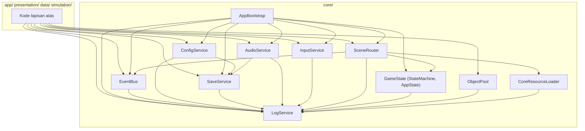

# CORE-FRAMEWORK-ARCHITECTURE: Desain Arsitektur Core Framework

- Status: Approved (disetujui pemilik proyek pada 2026-10-31)
- Tahap roadmap: SDD-02 (Core Framework)
- Dokumen requirement terkait: CORE-FRAMEWORK-REQUIREMENTS (Approved, 2026-10-30)
- Basis audit: HEAD `ec3ccae` (branch tunggal `main`)
- Terakhir diperbarui: 2026-10-31

## 1. Tujuan dan Ruang Lingkup

Dokumen ini adalah dokumen induk Technical Design SDD-02. Tujuannya menerjemahkan seluruh requirement Core Framework yang telah disetujui menjadi rancangan teknis yang konsisten dengan Godot 4.7.2-stable, GDScript, dan arsitektur berlapis TECHNICAL_ARCHITECTURE bagian 3.

Ruang lingkup dokumen ini: arsitektur keseluruhan Core Framework, daftar autoload final (OJ-2), tata letak berkas pada `game/src/core/`, serta rancangan lima modul yang tidak memiliki dokumen khusus: SceneRouter, GameState, ConfigService, AudioService, dan area Resource Management (ObjectPool dan CoreResourceLoader). Rancangan modul lain tersebar pada dokumen khusus sebagaimana tabel pemetaan pada bagian 2. Tidak ada kode implementasi pada tahap ini; seluruh antarmuka bersifat rancangan dan tanda tangan finalnya ditetapkan pada tahap Specification SDD-02.

## 2. Requirement yang Dilayani

| Dokumen | Lingkup | Requirement Utama |
| --- | --- | --- |
| Dokumen ini | Arsitektur keseluruhan; SceneRouter; GameState; ConfigService; AudioService; ObjectPool; CoreResourceLoader | FR-005 s.d. FR-010, FR-015 s.d. FR-018, FR-024 s.d. FR-026, FR-032 s.d. FR-034, NFR-003, NFR-008, INT-003, INT-005, INT-006, INT-007 |
| SERVICE-RESPONSIBILITY-MATRIX | Pemetaan tanggung jawab dan antarmuka seluruh modul | NFR-008; seluruh CFR-FR |
| SERVICE-DEPENDENCY-DESIGN | Graf ketergantungan dan penegakannya | Bagian 8 requirement; NFR-008 |
| INITIALIZATION-LIFECYCLE-DESIGN | AppBootstrap, urutan boot, siklus hidup Android | FR-001 s.d. FR-004, INT-101 s.d. INT-104, INT-003 |
| EVENT-BUS-DESIGN | EventBus | FR-011 s.d. FR-014 |
| INPUT-SYSTEM-DESIGN | InputService | FR-027, FR-028 |
| LOGGING-SYSTEM-DESIGN | LogService | FR-029 s.d. FR-031 |
| SAVE-SERVICE-DESIGN | SaveService dan kerangka migrasi | FR-019 s.d. FR-023, INT-001 s.d. INT-004 |
| CORE-FRAMEWORK-TEST-ARCHITECTURE | Struktur pengujian dan integrasi CI | Bagian 15 requirement; AC-001 s.d. AC-008 |

Keputusan yang mengikat desain ini dan telah disetujui pemilik proyek pada 2026-10-31: OJ-1 (autoload AppBootstrap; usulan P-019), OJ-2 (autoload per layanan; usulan P-020), OJ-3 (façade input minimal; usulan P-021), OJ-4 (log bergulir 3 berkas, 512 KB per berkas, bawaan WARN; usulan P-022), serta OJ-5 (harness kustom; diputuskan 2026-10-30).

## 3. Rancangan Teknis

### 3.1 Tata Letak Berkas

Seluruh kode layanan berada pada `game/src/core/` sesuai REPOSITORY-STRUCTURE-SPEC bagian 4 dan jadwal bagian 5 (direktori `src/core/` telah tersedia sejak SDD-01). Penamaan mengikuti aturan snake_case pada bagian 6 spesifikasi tersebut.

| Berkas | Jenis | Modul (requirement bagian 7) | Keterangan |
| --- | --- | --- | --- |
| `app_bootstrap.gd` | Autoload `AppBootstrap` | A | Titik masuk siklus hidup; detail pada INITIALIZATION-LIFECYCLE-DESIGN. |
| `log_service.gd` | Autoload `LogService` | I | Detail pada LOGGING-SYSTEM-DESIGN. |
| `event_bus.gd` | Autoload `EventBus` | D | Detail pada EVENT-BUS-DESIGN. |
| `config_service.gd` | Autoload `ConfigService` | E | Rancangan pada bagian 3.6 dokumen ini. |
| `save_service.gd` | Autoload `SaveService` | F | Detail pada SAVE-SERVICE-DESIGN. |
| `audio_service.gd` | Autoload `AudioService` | G | Rancangan pada bagian 3.7 dokumen ini. |
| `input_service.gd` | Autoload `InputService` | H | Detail pada INPUT-SYSTEM-DESIGN. |
| `scene_router.gd` | Autoload `SceneRouter` | B | Rancangan pada bagian 3.4 dokumen ini. |
| `state_machine.gd` | `class_name StateMachine` (RefCounted) | C | Pustaka murni; rancangan pada bagian 3.5. |
| `app_state.gd` | `class_name AppState` (RefCounted) | C | Status aplikasi tingkat atas; rancangan pada bagian 3.5. |
| `object_pool.gd` | `class_name ObjectPool` (RefCounted) | J | Pustaka murni; rancangan pada bagian 3.8. |
| `resource_loader.gd` | `class_name CoreResourceLoader` (RefCounted) | J | Pemuatan asinkron; rancangan pada bagian 3.8. |
| `save_store.gd`, `save_migration.gd`, `save_space_probe.gd` | `class_name` murni | F | Internal SaveService; detail pada SAVE-SERVICE-DESIGN. |

Ketentuan: satu berkas entri utama per layanan (CFR-NFR-008); berkas internal pendukung hanya bila tanggung jawabnya berbeda nyata (pembedahan SaveService dibenarkan karena mengimplementasikan dua spesifikasi penuh); tidak ada direktori kosong.

### 3.2 Daftar Autoload Final (OJ-2; Usulan P-020)

| Urutan | Autoload | Tanggung Jawab | Justifikasi atas Rencana Awal Arsitektur Bagian 6 |
| --- | --- | --- | --- |
| 1 | `AppBootstrap` | Urutan inisialisasi, degradasi, penutupan, notifikasi Android. | Diperlukan oleh keputusan OJ-1. |
| 2 | `LogService` | Pencatatan terpusat sejak langkah pertama boot. | Kegagalan layanan lain wajib tercatat; layanan paling awal dipakai lintas modul. |
| 3 | `EventBus` | Komunikasi publish-subscribe tervalidasi. | Sudah pada rencana awal. |
| 4 | `ConfigService` | Konfigurasi bertingkat dan pengaturan pemain. | Sudah pada rencana awal. |
| 5 | `SaveService` | Persistensi, migrasi, pemulihan. | Sudah pada rencana awal. |
| 6 | `AudioService` | Volume per kategori, pemutaran terkendali. | Sudah pada rencana awal. |
| 7 | `InputService` | Façade action map dan input sintetis. | Mencegah pembacaan input tersebar (CFR-FR-027); keputusan OJ-3. |
| 8 | `SceneRouter` | Routing scene bernama, pemuatan asinkron. | Sudah pada rencana awal; diletakkan terakhir karena aktif setelah seluruh layanan siap. |

Urutan deklarasi autoload pada `project.godot` diselaraskan dengan urutan inisialisasi sebagai lapisan pertahanan pertama, namun urutan yang benar-benar ditegakkan adalah panggilan inisialisasi eksplisit oleh AppBootstrap mengikuti requirement bagian 9 (CFR-FR-001): AppBootstrap memanggil metode `initialize()` tiap layanan sesuai urutan dan memvalidasi prasyarat; layanan yang dipanggil sebelum waktunya mengembalikan kegagalan eksplisit. Pendaftaran autoload dilakukan pada tahap implementasi dan saat itu harness fondasi TF-01 s.d. TF-08 diverifikasi ulang (CFR-INT-006, CFR-INT-007). `GameState` (StateMachine dan AppState), `ObjectPool`, dan `CoreResourceLoader` bukan autoload: pustaka murni yang dipegang melalui komposisi (requirement bagian 8 ketentuan 2).

### 3.3 Diagram Modul

Graf lengkap beserta larangannya ditetapkan pada SERVICE-DEPENDENCY-DESIGN; tidak ada ketergantungan melingkar (requirement bagian 8 ketentuan 3).

### 3.4 SceneRouter (CFR-FR-005 s.d. FR-008)

Rancangan:

1. Registry route terpusat dan konstan: nama route dipetakan ke path scene. Seluruh transisi hanya melalui `go_to(route_name)`; route tak terdaftar ditolak dengan error eksplisit dan log (FR-005).
2. Siklus transisi: pra-hook (bersihkan state transien, validasi status aplikasi) → pemuatan asinkron melalui CoreResourceLoader dengan laporan kemajuan (callback per status, FR-006) → aktivasi scene baru → pasca-hook → pelepasan scene lama.
3. Pelepasan memori (FR-007): scene lama hanya dibebaskan setelah scene baru aktif dan pasca-hook selesai; pelepasan mencakup `queue_free()` dan penghapusan referensi cache; router menyediakan satu titik pembersihan eksplisit `release_previous()`.
4. Mode headless (FR-008): seluruh transisi direkam pada buffer riwayat internal dan log sehingga pengujian CI dapat mengasertasi urutan transisi tanpa rendering.
5. Scene awal: scene boot SDD-01 tetap menjadi scene utama `project.godot`; SceneRouter tidak melakukan transisi otomatis apa pun hingga lobby tersedia pada SDD-04 (CFR-INT-007).

### 3.5 GameState (CFR-FR-009, FR-010)

Rancangan:

1. `StateMachine` generik (RefCounted, tanpa prasyarat layanan): `add_state(name)`, `add_transition(from, to, guard: Callable)`, `transition_to(name)`, `current()`, signal `state_changed(old, new)`. Transisi tidak terdaftar ditolak tanpa efek samping dan dicatat ke log melalui logger yang disuntikkan pada konstruksi (FR-009).
2. `AppState` memakai pustaka tersebut untuk status aplikasi tingkat atas. Status pada SDD-02: `BOOT` dan `READY`. Status `LOBBY`, `MATCH`, dan `RESULT` didaftarkan pada tahap masing-masing tanpa mengubah pustaka.
3. Konsistensi status dan route (FR-010): SceneRouter memperbarui AppState pada setiap transisi berhasil; API kueri `current_state()`, `is_in_state(name)`; pelanggaran konsistensi menghasilkan error eksplisit.

### 3.6 ConfigService (CFR-FR-015 s.d. FR-018)

Rancangan:

1. Dua fase inisialisasi: langkah 3 boot memuat nilai default bawaan; langkah 6 menerapkan pengaturan pemain dari store `settings` (selaras requirement bagian 9).
2. Pemuatan bertingkat (FR-015): berkas dasar dibaca dari `res://config/`; berkas dengan nama sama pada `user://assets_override/` menimpa nilai; penimpa yang gagal divalidasi diabaikan dengan peringatan dan nilai dasar tetap dipakai.
3. Kerangka validasi dasar (FR-016): skema deklaratif ringan per berkas konfigurasi (keberadaan berkas, keberadaan kunci, tipe nilai); kegagalan menghasilkan penolakan pemuatan dengan pesan jelas, bukan nilai bawaan senyap. Skema konten penuh menyusul SDD-03 (O-005, O-006).
4. Antarmuka pengaturan pemain (FR-017): `get_setting(key, default)`, `set_setting(key, value)`, signal `setting_changed(key, value)`. Penulisan disalurkan ke store `settings` melalui antrean SaveService, bukan menulis berkas langsung.
5. Kunci tak dikenal pada berkas lama (FR-018): dipakai nilai default dengan peringatan; boot tetap mencapai status siap.

### 3.7 AudioService (CFR-FR-024 s.d. FR-026)

Rancangan:

1. Kategori volume: `master`, `music`, `sfx`, `announcer`; tersimpan pada store `settings` dengan kunci `audio/<kategori>`; diterapkan pada langkah 7 boot (FR-024).
2. API pemutaran terkendali (FR-025): `play(stream, category) -> handle`, `stop(handle)`, `pause(category)`, `resume(category)`. Node pemutar diambil dari ObjectPool; jumlah node aktif dibatasi per kategori; penghentian mengembalikan node ke pool. Batas polyphony bawaan konservatif: music 1, sfx 8, announcer 2; nilai final ditetapkan pada Specification sesuai requirement bagian 12 nomor 6.
3. Headless aman (FR-026): saat berjalan tanpa perangkat audio (driver dummy pada mode headless), layanan memasuki jalur tanpa pembuatan node audio; API tetap valid dan tidak menghasilkan error.

### 3.8 ObjectPool dan CoreResourceLoader (CFR-FR-032 s.d. FR-034)

Rancangan ObjectPool (FR-032):

1. `setup(factory: Callable, reset: Callable, prewarm: int)`; `acquire()` hanya mengembalikan objek dari stok; bila stok habis, `acquire()` mengembalikan null dan pemanggil memutuskan secara eksplisit `grow(n)` atau menolak operasi; tidak ada alokasi implisit pada jalur acquire.
2. `release(obj)` memanggil reset dan mengembalikan objek ke stok; objek yang dilepas dua kali ditolak dengan error eksplisit.
3. `clear()` untuk pengujian; `active_count()` dan `stock_count()` untuk diagnostik.

Rancangan CoreResourceLoader (FR-034):

1. `load_async(path, timeout_ms, progress_callback)` dibangun di atas `ResourceLoader.load_threaded_request` dan `load_threaded_get_status`.
2. Batas waktu ditegakkan dengan pemeriksaan pada setiap siraman; lewat batas menghasilkan hasil gagal eksplisit dengan status dan path pada pesan; tidak pernah menggantung tanpa batas.
3. Digunakan oleh SceneRouter dan tersedia bagi lapisan data pada SDD-03.

## 4. Kontrak Antarmodul

| Modul | Antarmuka Utama (rancangan; final pada Specification) |
| --- | --- |
| AppBootstrap | `initialize()`, `is_ready()`, `degraded_services()`, `shutdown()`, `current_app_state()` |
| SceneRouter | `go_to(route)`, `register_route(name, path)`, `transition_history()`, `release_previous()` |
| GameState | StateMachine: `add_state`, `add_transition`, `transition_to`, `current`; AppState: `current_state()`, `is_in_state(name)`, signal `state_changed` |
| EventBus | `register_event(name, mode)`, `subscribe(name, callable)`, `unsubscribe(name, callable)`, `emit(name, payload)`, `clear_all()` |
| ConfigService | `load_config(file)`, `get_setting(key, default)`, `set_setting(key, value)`, signal `setting_changed` |
| SaveService | `get_store(name)`, `queue_write(name)`, `flush()`, `store_status(name)`, `run_migrations()` |
| AudioService | `play(stream, category)`, `stop(handle)`, `pause(category)`, `set_volume(category, value)` |
| InputService | `is_action_pressed(action)`, `is_action_just_pressed(action)`, `inject_press(action)`, `inject_release(action)` |
| LogService | `debug(module, message)`, `info`, `warn`, `error`, `set_level(level)`, `flush()` |
| ObjectPool | `setup(factory, reset, prewarm)`, `acquire()`, `release(obj)`, `grow(n)`, `clear()` |
| CoreResourceLoader | `load_async(path, timeout_ms, progress_cb)`, `load_sync(path)` |

Ketentuan kontrak: antarmuka layanan stabil dan menjadi satu-satunya jalur akses; tidak ada modul non-SaveService yang menyentuh `user://saves/` (requirement bagian 14 nomor 1); log tidak dibaca modul lain selain untuk diagnostik yang ditetapkan.

## 5. Penanganan Kesalahan

Klasifikasi mengikuti requirement bagian 13: kegagalan fatal boot, kegagalan terdegradasi, kegagalan data.

| Modul | Kegagalan Contoh | Kelas | Perlakuan |
| --- | --- | --- | --- |
| SceneRouter | Route tak terdaftar; pemuatan melebihi batas waktu. | Terdegradasi (transisi ditolak) / data. | Transisi ditolak dengan error eksplisit; route aktif dipertahankan; log ERROR. |
| GameState | Transisi tidak sah. | Terdegradasi. | Ditolak tanpa efek samping; log WARN. |
| ConfigService | Berkas konfigurasi atau penimpa rusak. | Data. | Penimpa diabaikan dengan peringatan; dasar dipakai; kegagalan berkas inti pada boot termasuk fatal (FR-002). |
| AudioService | Stream tidak valid; kehabisan batas polyphony. | Terdegradasi. | Operasi ditolak eksplisit; layanan dapat dinonaktifkan mode terdegradasi (FR-002). |
| ObjectPool | Stok habis; objek dilepas dua kali. | Terdegradasi. | Error eksplisit ke pemanggil; tidak ada alokasi senyap. |
| CoreResourceLoader | Batas waktu terlampaui. | Data. | Hasil gagal eksplisit; pemanggil menentukan kebijakan. |

Seluruh kegagalan layanan menghasilkan status kesalahan yang dapat ditanyai dan log; tidak ada pengecualian yang ditelan (CFR-FR-031).

## 6. Pertimbangan Performa

1. Jalur menganggur tanpa alokasi (CFR-NFR-005, FR-033): flush EventBus tidak mengalokasikan wadah baru; ObjectPool tidak mengalokasikan pada acquire; tidak ada polling per frame di luar kebutuhan nyata.
2. Transisi scene: pemuatan asinkron mencegah pembekuan frame (FR-006); pelepasan scene lama terjadwal setelah aktivasi untuk menghindari jeda.
3. Audio: batas polyphony membatasi jumlah node aktif; node dipool.
4. Kebijakan alokasi objek formal pada loop utama ditetapkan pada tahap Specification (CFR-FR-033, CFR-INT-005); desain ini menetapkan mekanisme pencegahannya (pool, buffer, tanpa alokasi implisit) sehingga kebijakan dapat ditegakkan pada audit.

## 7. Alternatif yang Dipertimbangkan

| Alternatif | Kelebihan | Kekurangan | Alasan Tidak Dipilih |
| --- | --- | --- | --- |
| Custom MainLoop/SceneTree (OJ-1 opsi a) | Kendali penuh siklus hidup. | Jalur kurang teruji pada export Android; berisiko terhadap kompatibilitas SDD-01; kompleks. | Ditolak pemilik proyek 2026-10-31; opsi (b) autoload bootstrap disetujui. |
| Service locator tunggal (OJ-2 opsi b) | Satu titik global. | Ketergantungan tersembunyi; melanggar semangat autoload minimum. | Ditolak pemilik proyek 2026-10-31; autoload per layanan disetujui. |
| Layanan Resource Management runtime tersendiri. | Keterpusatan pemuatan. | Tanggung jawab kabur dengan ConfigService dan SceneRouter; kebijakan cukup dibakukan pada spesifikasi. | Requirement bagian 7 catatan konsolidasi: hanya ObjectPool yang menjadi kode. |
| Façade input penuh sejak SDD-02 (OJ-3 opsi a). | Tanpa penulisan ulang. | Desain prematur kontrol pertandingan. | Ditolak pemilik proyek 2026-10-31; façade minimal disetujui. |

## 8. Risiko Teknis dan Mitigasi

| Risiko | Kemungkinan | Dampak | Mitigasi |
| --- | --- | --- | --- |
| Permukaan global bertambah delapan autoload. | Sedang | Sedang | Kontrak ketergantungan SERVICE-DEPENDENCY-DESIGN; justifikasi per autoload; audit per tahap. |
| Pendaftaran autoload mengubah jalur startup yang divalidasi harness fondasi. | Sedang | Tinggi | Verifikasi ulang TF-01 s.d. TF-08 pada tahap implementasi (CFR-INT-007). |
| Pelepasan scene meninggalkan referensi menggantung. | Sedang | Sedang | Titik pelepasan eksplisit; integration test penghitungan referensi (FR-007). |
| Semantik error `load_threaded` berbeda ekspektasi. | Rendah | Sedang | Batas waktu eksplisit dan unit test batas waktu (FR-034). |

## 9. Strategi Pengujian

Pustaka murni (StateMachine, ObjectPool, CoreResourceLoader) diuji unit tanpa prasyarat layanan; layanan diuji dengan stub penyuntikan; integration test boot, transisi headless, ubah-simpan-muat ulang pengaturan mengikuti CORE-FRAMEWORK-TEST-ARCHITECTURE. Pemetaan requirement ke suite tercantum pada SERVICE-RESPONSIBILITY-MATRIX.

## 10. Kriteria Penerimaan Desain

1. Seluruh CFR-FR, CFR-NFR, CFR-INT, dan CFR-AC terpetakan pada kesembilan dokumen desain (diverifikasi pada Tahap D).
2. Tidak ada pelanggaran pelapisan dan tidak ada ketergantungan melingkar.
3. Setiap layanan memiliki satu berkas entri dan satu tanggung jawab utama (CFR-NFR-008).
4. Keputusan OJ-1 s.d. OJ-4 tercatat pada DECISION_LOG sebagai P-019 s.d. P-022.
5. Pemilik proyek menyetujui desain sebelum tahap Specification dimulai.

## 11. Referensi

- CORE-FRAMEWORK-REQUIREMENTS (dokumen requirement tahap ini)
- TECHNICAL_ARCHITECTURE bagian 3, 6, 10
- REPOSITORY-STRUCTURE-SPEC bagian 4 s.d. 6
- GODOT-CONFIGURATION-SPEC bagian 5
- UPDATE-SYSTEM-SPEC bagian 5.2, 6
- DECISION_LOG: P-007 s.d. P-012, P-019 s.d. P-022 (usulan), OJ-1 s.d. OJ-5

## 12. Persetujuan

- Pemilik proyek: Ndolzz — Status: Disetujui pada 2026-10-31
