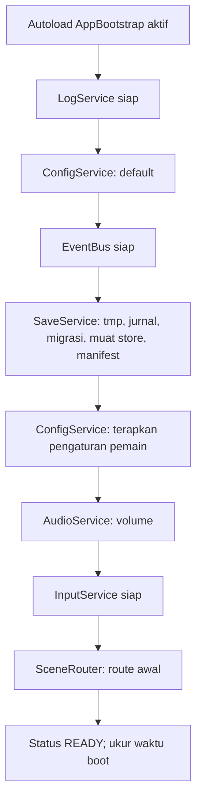

# INITIALIZATION-LIFECYCLE-DESIGN: Desain Siklus Hidup Inisialisasi dan Android

- Status: Approved (disetujui pemilik proyek pada 2026-10-31)
- Tahap roadmap: SDD-02 (Core Framework)
- Dokumen requirement terkait: CORE-FRAMEWORK-REQUIREMENTS (Approved, 2026-10-30)
- Basis audit: HEAD `ec3ccae` (branch tunggal `main`)
- Terakhir diperbarui: 2026-10-31

## 1. Tujuan dan Ruang Lingkup

Dokumen ini merancang AppBootstrap: titik masuk siklus hidup aplikasi yang menjamin urutan boot, penanganan kegagalan per layanan, penutupan normal, serta tanggapan terhadap siklus hidup Android (pause, resume, penghentian oleh sistem, penutupan atas permintaan). Desain ini menetapkan pilihan OJ-1: autoload AppBootstrap dengan scene utama biasa (disetujui pemilik proyek 2026-10-31, usulan P-019). Ruang lingkup: AppBootstrap, urutan inisialisasi requirement bagian 9, notifikasi Android pada CFR-INT-101 s.d. 104, dan penutupan normal CFR-FR-003. Pengujian siklus hidup dirinci pada CORE-FRAMEWORK-TEST-ARCHITECTURE.

## 2. Requirement yang Dilayani

CFR-FR-001 (urutan boot terkendali), CFR-FR-002 (kegagalan terpisah per layanan), CFR-FR-003 (penutupan normal), CFR-FR-004 (idempotensi boot), CFR-INT-101 s.d. CFR-INT-104 (siklus hidup Android), CFR-INT-003 (kesesuaian urutan boot pembaruan terhadap UPDATE-SYSTEM-SPEC bagian 6), CFR-AC-002, CFR-AC-004, CFR-AC-005.

## 3. Rancangan Teknis

### 3.1 AppBootstrap sebagai Autoload

AppBootstrap adalah autoload pertama sesuai daftar final OJ-2. Scene utama `project.godot` tetap `res://src/app/boot.tscn` milik SDD-01 yang pasif: hanya menampilkan identitas dan versi, tidak membaca store, dan tidak memicu inisialisasi layanan (CFR-INT-007). Seluruh inisialisasi berjalan di AppBootstrap sebelum SceneRouter melakukan transisi pertama; karena scene boot pasif, kondisi "scene aktif sebelum siap" tidak menimbulkan pembacaan data premature.

### 3.2 Urutan Inisialisasi

Urutan berikut identik dengan requirement bagian 9 dan selaras UPDATE-SYSTEM-SPEC bagian 6 (CFR-INT-003). Setiap langkah dipanggil eksplisit oleh AppBootstrap; hasil tiap langkah diperiksa sebelum langkah berikutnya.

| Langkah | Tindakan | Prasyarat | Kegagalan | Konfirmasi Boot |
| --- | --- | --- | --- | --- |
| 1 | AppBootstrap aktif sebagai autoload pertama. | Engine menambahkan autoload sesuai deklarasi. | Fatal: tidak mungkin (konstruksi engine). | Log internal. |
| 2 | LogService siap. | Berkas `user://logs/` dapat dibuat. | Fatal boot: pesan jelas lalu berhenti. | Log pertama tercatat. |
| 3 | ConfigService memuat nilai default bawaan. | LogService siap. | Fatal boot (dasar). | Jumlah konfigurasi dasar tercatat. |
| 4 | EventBus siap; register event diaudit. | LogService siap. | Fatal boot. | Register event dimuat. |
| 5 | SaveService: bersihkan `user://tmp/`, periksa jurnal migrasi dan pulihkan cadangan bila perlu, jalankan migrasi bila perlu, muat store, periksa manifest aset penimpa (titik sedia; tanpa paket aktif pada rilis awal sesuai O-020). | LogService siap. | Fatal boot (Save kritis per FR-002); kegagalan satu store masuk mode aman tanpa menghentikan store lain. | Status tiap store tercatat. |
| 6 | ConfigService menerapkan pengaturan pemain dari store `settings`. | SaveService siap; ConfigService dasar dimuat. | Terdegradasi: nilai default dipakai dengan peringatan. | Jumlah kunci pengaturan diterapkan. |
| 7 | AudioService menerapkan volume tersimpan. | ConfigService langkah 6 selesai. | Terdegradasi: mode tanpa audio (FR-002). | Volume per kategori tercatat. |
| 8 | InputService siap (mendaftarkan action map). | LogService siap. | Terdegradasi: façade tanpa injeksi. | Jumlah aksi terdaftar. |
| 9 | SceneRouter siap; scene aktif (scene boot SDD-01) dinyatakan sebagai route awal. | Seluruh langkah 2 s.d. 8 selesai. | Fatal boot. | Route awal tercatat. |
| 10 | Status aplikasi berubah menjadi READY pada AppState; layanan bertanda siap. | Langkah 9 selesai. | - | Waktu boot dicatat (requirement bagian 12 nomor 1). |

Pelanggaran prasyarat menghasilkan kegagalan eksplisit, bukan perilaku tak terdefinisi (CFR-FR-001). Layanan kritis: LogService, ConfigService dasar, SaveService; layanan sekunder: AudioService, InputService (CFR-FR-002). Daftar layanan yang terdegradasi dapat ditanyai melalui `degraded_services()` dan dilaporkan pada log.

### 3.3 Diagram Alur Boot

### 3.4 Penutupan Normal (CFR-FR-003)

Urutan penutupan: (1) siram antrean tulis SaveService hingga kosong; (2) hentikan seluruh pemutaran audio dan kembalikan node ke pool; (3) catat status penutupan dan siram buffer LogService; (4) izinkan proses keluar. Setiap langkah diberi tenggat internal; tenggat terlampaui menghasilkan peringatan dan langkah berikutnya tetap berjalan agar penutupan tidak menggantung.

### 3.5 Siklus Hidup Android

| Notifikasi | Sumber Godot | Perlakuan | Requirement |
| --- | --- | --- | --- |
| Pause oleh sistem | `NOTIFICATION_APPLICATION_PAUSED` pada AppBootstrap | Hentikan sementara audio; abaikan input (status internal `paused` yang dibaca InputService); siram antrean tulis SaveService dan buffer LogService; setelah notifikasi, tidak ada penulisan baru hingga resume. | CFR-INT-101 |
| Resume | `NOTIFICATION_APPLICATION_RESUMED` | Pulihkan audio; aktifkan kembali input; status aplikasi dan route diperiksa konsistennya, tidak dibangun ulang. | CFR-INT-102 |
| Penghentian paksa | Tanpa notifikasi (proses mati) | Tanpa perlakuan saat mati. Ketahanan bergantung pada penulisan atomik dan jurnal migrasi; pemulihan otomatis berjalan pada boot berikutnya (langkah 5). | CFR-INT-103 |
| Penutupan atas permintaan | `NOTIFICATION_WM_CLOSE_REQUEST` | Jalankan prosedur penutupan normal bagian 3.4. | CFR-INT-104 |

Ketentuan: flush pada pause adalah lapisan pertama, bukan satu-satunya; jaminan terakhir tetap penulisan atomik, cadangan, dan jurnal (CFR-INT-103). Handler notifikasi ditulis sebagai metode terpisah yang dapat dipanggil langsung oleh pengujian tanpa menunggu notifikasi sungguhan dari OS.

### 3.6 Idempotensi Boot (CFR-FR-004)

Boot normal tanpa perubahan versi schema tidak melakukan penulisan pada store: SaveService hanya membaca (pemeriksaan versi dan checksum); pengaturan diterapkan ke memori tanpa menulis; tidak ada penulisan store pada langkah 3 s.d. 10. Pengujian membandingkan stempel waktu berkas store sebelum dan sesudah boot ganda.

### 3.7 Pengukuran Waktu Boot

Waktu dari awal langkah 2 hingga langkah 10 diukur dengan `Time.get_ticks_msec()` dan dicatat pada log serta laporan verifikasi (requirement bagian 12 nomor 1: diukur dan dilaporkan, tanpa target keras pada SDD-02).

## 4. Kontrak Antarmodul

AppBootstrap mengekspos: `initialize()`, `is_ready()`, `degraded_services()`, `current_app_state()`, `request_shutdown()`, serta handler `handle_pause()`, `handle_resume()`, `handle_close_request()` yang juga dipakai pengujian. AppBootstrap tidak mengekspos layanan individual; akses layanan tetap melalui nama autoload masing-masing (OJ-2). AppBootstrap adalah satu-satunya modul yang mengenal seluruh layanan sekaligus (komposisi dan urutan; requirement bagian 8).

## 5. Penanganan Kesalahan

Kegagalan fatal boot (layanan kritis): boot berhenti, pesan kepada pemain non-teknis dan jelas, pesan teknis lengkap pada log (requirement bagian 13). Kegagalan terdegradasi (layanan sekunder): boot berlanjut, layanan tercatat pada `degraded_services()`, peringatan pada log; pengujian boot dengan layanan sekunder di-stub gagal membuktikan status siap tetap tercapai (CFR-FR-002). Tidak ada inisialisasi ulang atau penghapusan store sebagai akibat kegagalan (requirement bagian 13 nomor 3).

## 6. Pertimbangan Performa

Inisialisasi berurutan eksplisit memungkinkan pengukuran per langkah; langkah 5 (SaveService) adalah satu-satunya langkah berpotensi lama (migrasi) dan hanya terjadi setelah pembaruan. Jalur boot tidak melakukan pekerjaan per-frame; setelah status READY, AppBootstrap hanya menunggu notifikasi siklus hidup. Notifikasi pause melakukan siraman sinkron yang berukuran kecil (antrean tulis dan buffer log dibatasi ukurannya pada dokumen masing-masing).

## 7. Alternatif yang Dipertimbangkan

| Alternatif | Kelebihan | Kekurangan | Alasan Tidak Dipilih |
| --- | --- | --- | --- |
| Custom MainLoop/SceneTree (OJ-1 opsi a). | Kendali penuh; inisialisasi paling awal. | Mengubah jalur startup yang divalidasi harness SDD-01; berisiko pada export Android; sulit diuji headless; kompleks. | Ditolak pemilik proyek 2026-10-31. |
| Inisialisasi tersebar: tiap autoload menunggu dependensinya sendiri. | Tanpa orkestrator. | Urutan implisit sulit diaudit; pelanggaran prasyarat senyap. | Melanggar CFR-FR-001. |
| Init paralel untuk layanan tak bergantung (mis. Audio dan Save serentak). | Boot lebih cepat. | Kompleksitas sinkronisasi tidak sepadan pada tahap ini; pengukuran belum menunjukkan kebutuhan. | Ditetapkan ulang setelah pengukuran waktu boot pada verifikasi bila terbukti perlu. |

## 8. Risiko Teknis dan Mitigasi

| Risiko | Kemungkinan | Dampak | Mitigasi |
| --- | --- | --- | --- |
| Notifikasi pause tiba setelah buffer frame; siraman terlambat. | Rendah | Sedang | Penulisan atomik dan jurnal tetap menjadi jaminan akhir (CFR-INT-103); antrean dan buffer dibatasi ukurannya. |
| Scene boot aktif sebelum inisialisasi selesai dan kelihatan menggantung. | Sedang | Rendah | Scene boot pasif menampilkan teks versi; READY cepat pada perangkat target; pengukuran waktu boot dilaporkan. |
| Perbedaan urutan deklarasi autoload dan urutan panggilan menimbulkan kebingungan. | Rendah | Sedang | Keduanya disamakan pada daftar final OJ-2; urutan sebenarnya ditegakkan AppBootstrap. |

## 9. Strategi Pengujian

`core_boot_tests.gd`: urutan langkah (CFR-FR-001), boot dengan layanan sekunder gagal (FR-002), penutupan normal (FR-003), idempotensi boot ganda via stempel waktu store (FR-004). `core_integration_tests.gd`: pause-resume disimulasikan dengan memanggil handler (INT-101, INT-102), pemulihan kill disimulasikan pada titik tulis dan migrasi (INT-103, AC-004), penutupan atas permintaan (INT-104). Notifikasi sungguhan dari OS diuji manual pada perangkat QA saat verifikasi.

## 10. Kriteria Penerimaan Desain

1. Urutan 3.2 identik dengan requirement bagian 9 dan UPDATE-SYSTEM-SPEC bagian 6.
2. Setiap kegagalan layanan memiliki kelas dan perlakuan eksplisit (FR-002).
3. Keempat notifikasi Android memiliki perlakuan dan pengujian (INT-101 s.d. INT-104).
4. Penutupan normal dan idempotensi teruji (FR-003, FR-004).
5. Pemilik proyek menyetujui sebelum tahap Specification.

## 11. Referensi

- CORE-FRAMEWORK-REQUIREMENTS bagian 4, 9, 10, 12, 13, 16
- UPDATE-SYSTEM-SPEC bagian 6 (urutan boot pembaruan)
- DATA-MIGRATION-SPEC bagian 5, 7 (jurnal dan pemulihan)
- CORE-FRAMEWORK-ARCHITECTURE bagian 3.1, 3.2 (autoload dan tata letak)
- SAVE-SERVICE-DESIGN (rincian langkah 5)
- DECISION_LOG: P-019 (usulan; OJ-1)

## 12. Persetujuan

- Pemilik proyek: Ndolzz — Status: Disetujui pada 2026-10-31
