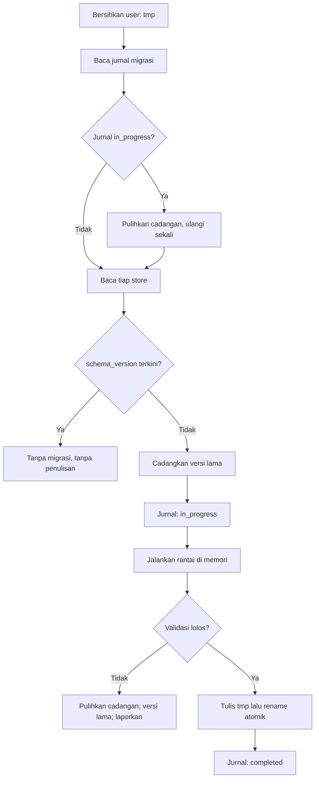

# SAVE-SERVICE-DESIGN: Desain SaveService dan Kerangka Migrasi

- Status: Approved (disetujui pemilik proyek pada 2026-10-31)
- Tahap roadmap: SDD-02 (Core Framework)
- Dokumen requirement terkait: CORE-FRAMEWORK-REQUIREMENTS (Approved, 2026-10-30)
- Basis audit: HEAD `ec3ccae` (branch tunggal `main`)
- Terakhir diperbarui: 2026-10-31

## 1. Tujuan dan Ruang Lingkup

Dokumen ini merancang SaveService: satu-satunya pemilik akses `user://saves/` yang mengimplementasikan DATA-PERSISTENCE-SPEC secara penuh (CFR-FR-019) dan menyediakan kerangka DATA-MIGRATION-SPEC (CFR-FR-020). Ruang lingkup: amplop store dan checksum, penulisan atomik, antrean tulis, pemeriksaan ruang, pemulihan store, registri dan rantai migrasi, jurnal, cadangan, mode aman, serta mode `--migrate-only` headless. Struktur isi tiap store didefinisikan pada tahap masing-masing (misalnya struktur rank pada SDD-10) dan berada di luar lingkup; daftar store mengikuti DATA-PERSISTENCE-SPEC bagian 6.

## 2. Requirement yang Dilayani

CFR-FR-019 (implementasi persistensi penuh), CFR-FR-020 (kerangka migrasi), CFR-FR-021 (momen simpan minimum), CFR-FR-022 (pemeriksaan ruang simpan), CFR-FR-023 (pemulihan store), CFR-FR-004 (idempotensi boot), CFR-INT-001 (kesesuaian DATA-PERSISTENCE-SPEC), CFR-INT-002 (kesesuaian DATA-MIGRATION-SPEC), CFR-INT-003 (kesesuaian urutan boot pembaruan), CFR-INT-004 (integrasi CI dan mode `--migrate-only`), CFR-INT-103 (penghentian oleh sistem), CFR-NFR-006 (tulis tanpa blok), CFR-NFR-007 (waktu tulis terukur), CFR-AC-003, CFR-AC-004, CFR-AC-006.

## 3. Rancangan Teknis

### 3.1 Struktur Internal

| Berkas | Tanggung Jawab |
| --- | --- |
| `save_service.gd` (autoload) | Antrean tulis, momen simpan, orkestrasi langkah boot langkah 5, status store, antarmuka publik. |
| `save_store.gd` | Amplop store, checksum, penulisan dan penggantian nama atomik, pemuatan, mode aman, karantina. |
| `save_migration.gd` | Registri langkah, rantai migrasi, jurnal, cadangan, pemulihan, `--migrate-only`. |
| `save_space_probe.gd` | Strategi pemeriksaan ruang bebas. |

Seluruh operasi berkas melewati pembungkas berkas tipis pada `save_store.gd` yang dapat diganti implementasi memori pada pengujian (requirement bagian 15 nomor 2).

### 3.2 Amplop dan Checksum (DATA-PERSISTENCE-SPEC Bagian 7)

Amplop: `schema_version`, `app_version_written`, `checksum`, `data`, sesuai spesifikasi. Checksum dihitung atas representasi kanonik `data`: `JSON.stringify(data, "", true)` (kunci terurut) yang di-hash SHA-256 melalui `Crypto.hash`. Kanonisasi memastikan checksum stabil terhadap urutan kunci kamus; pemuatan menghitung ulang dan membandingkan. Kegagalan kecocokan memicu pemulihan (bagian 3.6). Versi aplikasi pada `app_version_written` dibaca dari `game/version.json` (P-004) melalui `src/core/app_version.gd` SDD-01.

### 3.3 Penulisan Atomik dan Antrean (DATA-PERSISTENCE-SPEC Bagian 8)

1. Seluruh penulisan mengikuti urutan: tulis `user://tmp/<store>.tmp` → pastikan selesai → ganti nama menjadi `user://saves/<store>.store` (atomik pada sistem berkas). Tidak ada penulisan langsung ke berkas target; hanya `save_store.gd` yang menulis.
2. Antrean tulis tunggal: permintaan penulisan store masuk antrean (satu entri per store; entri menimpa entri sebelumnya untuk store yang sama karena hanya keadaan akhir yang berarti); antrean disiram pada momen aman: momen simpan minimum (bagian 3.4), pause (CFR-INT-101), penutupan normal (CFR-FR-003), dan titik setelah migrasi. Siraman tidak berjalan pada jalur per-frame (CFR-NFR-006).
3. Boot normal tanpa perubahan versi schema tidak menulis store apa pun (CFR-FR-004; DATA-MIGRATION-SPEC bagian 10 nomor 3).

### 3.4 Momen Simpan Minimum (CFR-FR-021)

Penulisan dipicu paling tidak pada: akhir pertandingan (ditandai lapisan app melalui antarmuka publik sejak SDD-05), perubahan pengaturan (dipicu ConfigService), perubahan rank (SDD-10), dan penutupan normal. Pada SDD-02, pemicu yang belum memiliki pemanggil (pertandingan, rank) diimplementasikan sebagai antarmuka yang siap dipanggil dan teruji dengan pemanggil uji.

### 3.5 Pemeriksaan Ruang (CFR-FR-022; DATA-PERSISTENCE-SPEC Bagian 12; DATA-MIGRATION-SPEC Bagian 9)

1. Sebelum menulis atau migrasi, layanan menghitung kebutuhan: dua kali ukuran store terbesar yang diketahui, ditambah estimasi cadangan untuk migrasi.
2. `save_space_probe.gd` memeriksa ruang bebas pada `user://`: pada Android melalui `StatFs` JavaClass bila tersedia; bila pemeriksaan tidak dapat dilakukan pada platform tertentu, layanan melanjutkan dengan pola atomik sebagai perlindungan (diperbolehkan spesifikasi bagian 12 nomor 3).
3. Ruang tidak mencukupi: penulisan ditunda dengan status dan pesan yang jelas; tidak ada penulisan parsial; data lama tetap utuh; penundaan dicatat pada log dan dapat ditanyai.

### 3.6 Pemuatan, Pemulihan, dan Mode Aman (CFR-FR-023; DATA-PERSISTENCE-SPEC Bagian 11)

Urutan pemuatan per store pada langkah 5 boot:

1. Baca berkas store; bila tidak ada: inisialisasi pertama, buat store default `schema_version` terkini dengan nilai aman; keberadaan berkas diperiksa sebelum penulisan (spesifikasi bagian 11 nomor 2).
2. Baca ada: verifikasi checksum. Cocok: muat `data`.
3. Tidak cocok: pulihkan cadangan terbaru `user://saves/backup/`; bila cadangan valid, gunakan dan catat pemulihan.
4. Tidak ada cadangan yang valid: mode aman: berkas lama dipindahkan ke `user://saves/quarantine/<store>.<stempel waktu>.corrupt` (tidak pernah dihapus), store baru dibuat dengan nilai default di memori dan ditandai `safe_mode`; modul pemakai membaca nilai default; pemain menerima pesan non-teknis sesuai requirement bagian 13 nomor 2.
5. Kegagalan satu store tidak menghentikan store lain; status per store (`ok`, `recovered`, `safe_mode`, `deferred`) dapat ditanyai.

### 3.7 Kerangka Migrasi (CFR-FR-020; DATA-MIGRATION-SPEC Bagian 4 s.d. 8)

1. Registri per store: langkah terurut menaik `migrate_<store>_<dari>_ke_<ke>`; setiap langkah fungsi murni (menerima struktur lama, mengembalikan struktur baru, tanpa efek samping berkas); kenaikan satu tingkat per langkah; langkah yang dirilis tidak pernah dihapus.
2. Jurnal `user://saves/migration_journal.json`: status per store `idle`, `in_progress`, `completed` beserta stempel waktu dan versi sumber. Ditulis `in_progress` sebelum langkah pertama; `completed` setelah rename atomik; penanda dihapus setelah selesai.
3. Cadangan: sebelum migrasi, salin store ke `user://saves/backup/<store>.v<versi_lama>.bak`; retensi paling banyak dua cadangan terbaru per store, terlama dihapus lebih dahulu; cadangan tidak pernah dihapus saat migrasi gagal; penghapusan hanya oleh kebijakan retensi.
4. Alur pada langkah 5 boot: bersihkan `user://tmp/` → baca jurnal; `in_progress` memicu pemulihan cadangan lalu percobaan ulang maksimal satu kali → per store: bandingkan `schema_version`; bila lebih rendah, cadangkan, tulis jurnal, jalankan rantai di memori, validasi hasil, tulis berkas sementara, rename atomik, jurnal `completed`. Rantai dikerjakan sepenuhnya di memori; berkas lama tetap utuh sampai rename berhasil.
5. Kegagalan migrasi (checksum lama invalid, hasil tidak lolos validasi, pengecualian, ruang habis): pulihkan cadangan, `schema_version` tetap versi lama, catat kegagalan, tampilkan pesan pemain sesuai UPDATE-SYSTEM-SPEC bagian 7 nomor 3 (data aman, versi lama digunakan); bila kode terkini tidak dapat membaca versi lama, store dinonaktifkan mode aman tanpa menghapus data (DATA-MIGRATION-SPEC bagian 8 nomor 3). Kegagalan satu store tidak menghentikan store lain. Tidak ada jalur yang menginisialisasi ulang atau menghapus store akibat kegagalan (bagian 8 nomor 5).
6. Setiap langkah migrasi wajib memiliki unit test dengan fixture versi lama (spesifikasi bagian 4 nomor 3); fixture disimpan pada `game/tests/fixtures/migration/`.

### 3.8 Mode `--migrate-only` (CFR-INT-002, CFR-INT-004; DATA-MIGRATION-SPEC Bagian 4 Nomor 5)

Skrip `game/tools/migrate_only.gd` dijalankan headless: `godot --headless --script res://tools/migrate_only.gd -- <direktori_store>`. Skrip menginstansiasi `save_migration.gd` langsung (tanpa scene dan tanpa layanan lain), membaca store dari direktori argumen (fixture CI atau salinan), menjalankan rantai, mencetak laporan per store, dan keluar dengan kode bukan nol bila ada kegagalan. Skrip menempati `tools/` sesuai REPOSITORY-STRUCTURE-SPEC (bukan runtime game) dan dikecualikan dari export APK bersama `tests/`.

### 3.9 Urutan pada Boot (CFR-INT-003; UPDATE-SYSTEM-SPEC Bagian 6)

Langkah 5 urutan boot (INITIALIZATION-LIFECYCLE-DESIGN bagian 3.2) memetakan satu-ke-satu pada urutan pembaruan spesifikasi: baca versi (langkah 1 spesifikasi dipenuhi AppBootstrap), inisialisasi layanan inti minimal (langkah 2), bersihkan `user://tmp/` (langkah 3), jurnal dan pemulihan (langkah 4), versi schema dan migrasi (langkah 5), manifest aset penimpa (langkah 6, titik sedia tanpa paket aktif per O-020), lalu muat profil dan masuk lobby (langkah 7; pada SDD-02 scene boot). Peninjauan silang menemukan nol konflik.

## 4. Kontrak Antarmodul

| Antarmuka | Rancangan |
| --- | --- |
| `initialize(space_probe, logger, app_version)` | Menyiapkan store dan menjalankan langkah 5 boot; dipanggil AppBootstrap. |
| `get_store(name) -> Dictionary` | Salinan data store untuk pemakai; modifikasi melalui `update_store`. |
| `update_store(name, mutator)` | Mengubah data store di memori dan mengantrekan penulisan. |
| `queue_write(name)` | Momen simpan eksplisit (FR-021). |
| `flush()` | Menyiram antrean; dipanggil pada pause, penutupan, dan pengujian. |
| `store_status(name)` | `ok`, `recovered`, `safe_mode`, `deferred`, `error`. |
| `register_migration(store, from, to, callable)` | Mendaftarkan langkah pada registri. |
| `free_space_report()` | Hasil pemeriksaan ruang terakhir. |

Ketergantungan: hanya LogService; ConfigService mengakses store `settings` melalui antarmuka ini (SERVICE-DEPENDENCY-DESIGN tabel 3.2). SaveService hanya boleh memancarkan event (mis. `save.store_written`), tidak berlangganan.

## 5. Penanganan Kesalahan

Klasifikasi mengikuti requirement bagian 13 dan dibedakan per kejadian: kegagalan inisialisasi `user://saves/` pada boot adalah fatal (layanan kritis); kegagalan satu store masuk mode aman tanpa menghentikan store lain (bagian 3.6); kegagalan penulisan akibat ruang ditunda dengan status `deferred` (bagian 3.5); kegagalan migrasi mengikuti prosedur bagian 3.7 nomor 5. Seluruh keadaan dapat ditanyai dan tercatat; tidak ada penelanan senyap (CFR-FR-031).

## 6. Pertimbangan Performa

1. Siraman antrean pada momen aman menjalankan penulisan di luar frame sensitif; penulisan paling besar (sampai 1 MB) ditargetkan selesai 50 ms atau kurang pada perangkat kelas QA dan diukur pada verifikasi (CFR-NFR-007; target, bukan gerbang keras).
2. Rantai migrasi dikerjakan di memori; penulisan hanya satu kali per store setelah validasi.
3. Antrean menyimpan satu entri per store sehingga penulisan berulang untuk store yang sama runtuh menjadi satu.
4. Boot normal tanpa migrasi tidak melakukan penulisan (CFR-FR-004) sehingga waktu boot tidak membayar biaya I/O tulis.

## 7. Alternatif yang Dipertimbangkan

| Alternatif | Kelebihan | Kekurangan | Alasan Tidak Dipilih |
| --- | --- | --- | --- |
| Basis data SQLite. | Kueri kaya; transaksi. | Menambah dependensi dan ukuran; kompleksitas migrasi tidak sepadan untuk data profil offline; bertentangan P-006. | JSON dengan amplop versi dan checksum telah dikunci P-006. |
| Penulisan langsung tanpa antrean. | Sederhana. | I/O pada jalur panggilan dapat memblokir frame; tulis bersamaan sulit dicegah. | Melanggar CFR-NFR-006 dan spesifikasi bagian 8 nomor 4. |
| Karantina tidak ada: berkas korup ditimpa default. | Tanpa kompleksitas karantina. | Melanggar FR-023 (tanpa menghapus berkas lama) dan spesifikasi bagian 11 nomor 2. | Karantina dipilih untuk kepatuhan penuh. |

## 8. Risiko Teknis dan Mitigasi

| Risiko | Kemungkinan | Dampak | Mitigasi |
| --- | --- | --- | --- |
| Pemeriksaan ruang tidak tersedia pada sebagian perangkat. | Sedang | Sedang | Strategi probe dengan fallback pola atomik (spesifikasi bagian 12 nomor 3); pengujian dengan stub. |
| Checksum tidak stabil akibat urutan kunci. | Rendah | Tinggi | Kanonisasi `JSON.stringify` kunci terurut; unit test penulisan-pembacaan. |
| Fixture migrasi usang saat langkah baru ditambah. | Rendah | Sedang | Setiap langkah baru wajib membawa fixture (spesifikasi bagian 4 nomor 3); audit checklist. |
| Kill tepat pada rename. | Rendah | Tinggi | Rename sistem berkas atomik; jurnal memicu pemulihan; kill test simulasi pada titik kritis (AC-004). |

## 9. Strategi Pengujian

`core_save_tests.gd`: amplop dan checksum (termasuk kanonisasi), penulisan atomik, antrean dan siraman, idempotensi boot (mtime), pemeriksaan ruang dengan stub (cukup dan tidak cukup), pemulihan checksum salah, mode aman dan karantina, ruang tertunda. `core_migration_tests.gd`: rantai multi versi, jurnal dan pemulihan `in_progress`, cadangan dan retensi dua terbaru, kegagalan langkah memulihkan cadangan, idempotensi migrasi. `core_integration_tests.gd`: migrasi otomatis pada boot dengan fixture versi lama (AC-003), kill simulasi saat tulis dan migrasi (AC-004), ubah-simpan-muat ulang pengaturan (AC-006). Mode `--migrate-only` dijalankan pada langkah CI terpisah (CFR-INT-004). Kill pada proses sungguhan dengan perangkat nyata dilakukan manual pada verifikasi perangkat.

## 10. Kriteria Penerimaan Desain

1. Seluruh ketentuan DATA-PERSISTENCE-SPEC bagian 7 s.d. 12 terpetakan pada bagian rancangan ini (checklist bagian 13 spesifikasi diverifikasi pada Tahap D).
2. Seluruh ketentuan DATA-MIGRATION-SPEC bagian 4 s.d. 9 terpetakan (checklist bagian 11 spesifikasi diverifikasi pada Tahap D).
3. Urutan boot selaras UPDATE-SYSTEM-SPEC bagian 6 tanpa konflik (CFR-INT-003).
4. Mode aman tidak pernah menghapus berkas lama; karantina terdefinisi.
5. Pemilik proyek menyetujui sebelum tahap Specification.

## 11. Referensi

- CORE-FRAMEWORK-REQUIREMENTS bagian 5.6, 9, 11, 13, 14
- DATA-PERSISTENCE-SPEC (seluruh bagian)
- DATA-MIGRATION-SPEC (seluruh bagian)
- UPDATE-SYSTEM-SPEC bagian 5, 6, 7, 8
- INITIALIZATION-LIFECYCLE-DESIGN bagian 3.2 (langkah 5)
- CORE-FRAMEWORK-TEST-ARCHITECTURE (suite dan CI)
- DECISION_LOG: P-004, P-006, O-019, O-020, O-021

## 12. Persetujuan

- Pemilik proyek: Ndolzz — Status: Disetujui pada 2026-10-31
