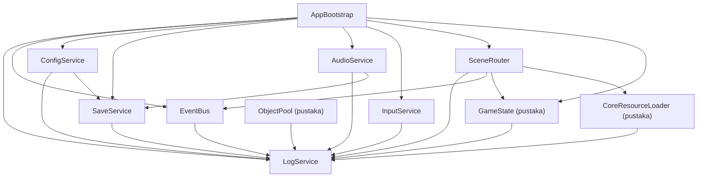

# SERVICE-DEPENDENCY-DESIGN: Desain Ketergantungan Layanan Core

- Status: Approved (disetujui pemilik proyek pada 2026-10-31)
- Tahap roadmap: SDD-02 (Core Framework)
- Dokumen requirement terkait: CORE-FRAMEWORK-REQUIREMENTS (Approved, 2026-10-30)
- Basis audit: HEAD `ec3ccae` (branch tunggal `main`)
- Terakhir diperbarui: 2026-10-31

## 1. Tujuan dan Ruang Lingkup

Dokumen ini menetapkan graf ketergantungan antar modul Core Framework, mekanisme penyuntikan dependensi, dan cara ketergantungan ditegakkan pada audit. Tujuannya mencegah global state tak terkendali dan ketergantungan tersembunyi (OJ-2), menjaga aturan pelapisan TECHNICAL_ARCHITECTURE bagian 3, dan menjamin pustaka murni dapat diuji tanpa prasyarat (requirement bagian 8 ketentuan 2). Ruang lingkup: ketergantungan statis antar modul core pada SDD-02; ketergantungan lapisan atas ke core dirinci pada tahap masing-masing.

## 2. Requirement yang Dilayani

Requirement bagian 8 (tabel ketergantungan dan ketentuan tambahan), CFR-NFR-008, dan requirement bagian 15 nomor 1 dan 2 (isolasi pengujian dan titik suntikan stub). Desain ini menegakkan pilihan OJ-2: autoload per layanan dengan ketergantungan eksplisit (disetujui pemilik proyek 2026-10-31, usulan P-020).

## 3. Rancangan Teknis

### 3.1 Graf Ketergantungan yang Diizinkan

Graf berikut adalah graf lengkap ketergantungan statis yang diizinkan pada SDD-02. Panah berarti "boleh bergantung pada".

### 3.2 Tabel Izin Ketergantungan

| Modul | Boleh Bergantung Pada | Tidak Boleh Bergantung Pada |
| --- | --- | --- |
| LogService | API berkas Godot saja. | Seluruh modul core lain. |
| EventBus | LogService. | ConfigService, SaveService, scene; hanya boleh memancarkan, tidak berlangganan ke layanan inti lain. |
| ConfigService | LogService, SaveService (hanya store settings melalui antarmuka). | EventBus sebagai pelanggan; scene. |
| SaveService | LogService. | ConfigService; EventBus sebagai pelanggan (hanya boleh memancarkan); scene. |
| GameState | LogService (disuntik, opsional). | Seluruh layanan lain. |
| SceneRouter | LogService, EventBus, GameState, CoreResourceLoader. | SaveService, ConfigService. |
| AudioService | LogService, SaveService (hanya melalui ConfigService sebagai jalur pengaturan; lihat catatan 1). | Scene. |
| InputService | LogService (disuntik, opsional). | Seluruh layanan lain. |
| AppBootstrap | Seluruh modul di atas, khusus komposisi dan urutan. | Lapisan di luar core. |
| ObjectPool | LogService (disuntik, opsional). | Seluruh layanan lain. |
| CoreResourceLoader | LogService (disuntik, opsional). | Seluruh layanan lain. |

Catatan:

1. Requirement bagian 8 mencatat AudioService bergantung pada SaveService melalui ConfigService: volume tersimpan pada store settings, dan jalur penulisan adalah ConfigService ke SaveService. AudioService tidak memanggil SaveService secara langsung; nilai volume dibaca dan ditulis melalui ConfigService sehingga graf tetap bebas dari jalur ganda.
2. Konfigurasi volume yang diterapkan AudioService pada boot (langkah 7) diterima sebagai nilai hasil ConfigService; AudioService menerima nilai, bukan referensi store.
3. Ketergantungan melingkar dilarang (requirement bagian 8 ketentuan 3); graf di atas terbukti bebas siklus secara konstruksi: LogService adalah satu-satunya akhir dan tidak bergantung pada modul core mana pun.

### 3.3 Pola Penyuntikan

1. Pustaka murni (StateMachine, AppState, ObjectPool, CoreResourceLoader) menerima dependensi melalui parameter konstruksi: `StateMachine.new(logger)` dengan logger bernilai null yang diizinkan (pustaka tetap berfungsi; penolakan transisi hanya dicatat bila logger tersedia). Dengan demikian pustaka dapat diuji terisolasi total (requirement bagian 15 nomor 1).
2. Layanan autoload menerima dependensi eksplisit pada `initialize()`: AppBootstrap memanggil `initialize()` tiap layanan dan meneruskan referensi yang dibenarkan tabel 3.2. Layanan tidak mengambil referensi layanan lain secara mandiri di dalam kode internalnya; pelanggaran ditemukan pada audit.
3. Titik suntikan stub untuk pengujian (requirement bagian 15 nomor 2): (a) operasi berkas SaveService melewati pembungkus berkas tipis yang dapat diganti implementasi memori; (b) pengecualian waktu pada CoreResourceLoader dapat disuntik; (c) audio headless dan input sintetis adalah jalur bawaan yang tidak memerlukan perangkat.
4. Akses lintas lapisan: lapisan app, data, simulation, dan presentation memanggil layanan core melalui nama autoload (antarmuka pada CORE-FRAMEWORK-ARCHITECTURE bagian 4); core tidak pernah memanggil ke atas.

### 3.4 Kebijakan Komunikasi

1. Pemanggilan langsung untuk kueri dan perintah yang wajib tersedia (contoh: ConfigService membaca store settings melalui SaveService).
2. EventBus untuk penyebaran status kepada pihak yang jumlahnya tidak diketahui (requirement bagian 8 ketentuan 1); daftar event dan pemiliknya ditetapkan pada EVENT-BUS-DESIGN.
3. Signal pada antarmuka layanan untuk perubahan yang berdampak lokal; signal dan event tidak dipakai bersamaan untuk kepentingan yang sama untuk menghindari dua jalur kebenaran.

## 4. Penegakan Ketergantungan

1. Audit kode per tahap memeriksa: setiap referensi antar modul tercantum pada tabel 3.2; pustaka murni tidak memegang referensi autoload; core tidak mengimpor lapisan di atasnya.
2. gdlint dan tinjauan kode menolak: pemanggilan `Engine.get_singleton`, referensi nama autoload di dalam pustaka murni, dan akses berkas langsung ke `user://saves/` di luar SaveService (requirement bagian 14 nomor 1).
3. Pengujian: suite per pustaka murni dijalankan tanpa autoload aktif sebagai bukti isolasi (requirement bagian 15 nomor 1).

## 5. Penanganan Kesalahan

Kegagalan penyuntikan (dependensi null pada saat `initialize()`) menghasilkan kegagalan eksplisit: layanan kritis menghentikan boot (CFR-FR-002), layanan sekunder masuk mode terdegradasi dan dicatat pada LogService. Tidak ada layanan yang berjalan dengan dependensi implisit yang tidak terisi.

## 6. Pertimbangan Performa

Penyuntikan pada inisialisasi berarti jalur per-frame tidak melakukan pencarian dependensi; seluruh referensi telah terisi sebelum status siap. EventBus dan ObjectPool yang beroperasi per-frame tidak memegang referensi layanan berat.

## 7. Alternatif yang Dipertimbangkan

| Alternatif | Kelebihan | Kekurangan | Alasan Tidak Dipilih |
| --- | --- | --- | --- |
| Service locator tunggal (OJ-2 opsi b). | Satu titik akses; suntikan terpusat. | Arah ketergantungan tidak terlihat; wadah menjadi objek tuhan; melanggar semangat autoload minimum arsitektur bagian 6. | Ditolak pemilik proyek 2026-10-31. |
| Ketergantungan penuh lewat EventBus (semua modul publish-subscribe). | Kopling minimum nominal. | Urutan dan ketersediaan panggilan wajib tidak dapat dijamin; debugging sulit. | Komunikasi prosedural wajib dikecualikan (requirement bagian 8 ketentuan 1). |
| Tanpa penyuntikan: layanan saling memanggil via nama autoload. | Sederhana. | Ketergantungan tersembunyi pada kode internal; pengujian terisolasi sulit. | Melanggar requirement bagian 15 nomor 1 dan 2. |

## 8. Risiko Teknis dan Mitigasi

| Risiko | Kemungkinan | Dampak | Mitigasi |
| --- | --- | --- | --- |
| Kode implementasi menyimpang dari tabel izin. | Sedang | Tinggi | Audit per tahap; penegakan butir 4.2; pelanggaran menggagalkan Code Audit. |
| Graf melingkar muncul saat tahap berikutnya menambah modul. | Rendah | Tinggi | Graf diperbarui pada dokumen ini sebelum modul baru ditulis; audit menolak siklus. |
| Pustaka murni diam-diam memegang referensi autoload. | Sedang | Sedang | Suite pustaka berjalan tanpa autoload; gdlint dan tinjauan menolak pola tersebut. |

## 9. Strategi Pengujian

Unit test pustaka murni tanpa prasyarat; integration test boot membuktikan urutan penyuntikan; audit kode membuktikan kepatuhan tabel 3.2. Pemetaan suite pada SERVICE-RESPONSIBILITY-MATRIX dan CORE-FRAMEWORK-TEST-ARCHITECTURE.

## 10. Kriteria Penerimaan Desain

1. Graf 3.1 identik dengan tabel requirement bagian 8 tanpa penambahan atau pengurangan izin.
2. Setiap ketergantungan statis memiliki mekanisme penyuntikan yang terdefinisi.
3. Ketergantungan melingkar: nol.
4. Pemilik proyek menyetujui sebelum tahap Specification.

## 11. Referensi

- CORE-FRAMEWORK-REQUIREMENTS bagian 8, 14, 15
- TECHNICAL_ARCHITECTURE bagian 3, 6
- CORE-FRAMEWORK-ARCHITECTURE (antarmuka dan urutan inisialisasi)
- INITIALIZATION-LIFECYCLE-DESIGN (urutan penyuntikan saat boot)
- EVENT-BUS-DESIGN (kebijakan komunikasi)

## 12. Persetujuan

- Pemilik proyek: Ndolzz — Status: Disetujui pada 2026-10-31
